<!-- ───────────────────────────── hero ───────────────────────────── -->
<a href="https://bhavna-j.vercel.app/">
  <picture>
    <source media="(prefers-reduced-motion: reduce)" srcset="https://raw.githubusercontent.com/BHAVNAJAY/BHAVNAJAY/main/assets/hero/hero-3d-v6-static.png">
    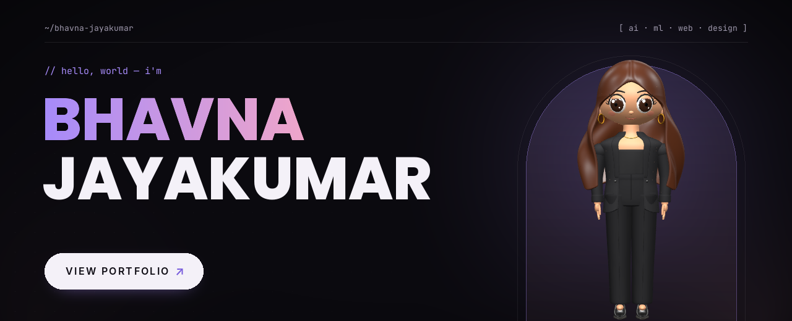
  </picture>
</a>

 

### `/ toolkit`

<code>01</code>&nbsp; <b>DEVELOPMENT</b>

  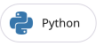
  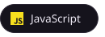
  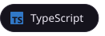
  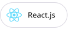
  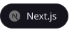
  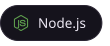
  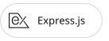
  
  
  
  
  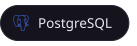
  
  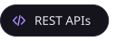
  
  

<code>02</code>&nbsp; <b>AI &amp; MACHINE LEARNING</b>

  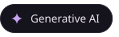
  
  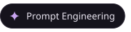
  
  
  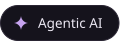
  
  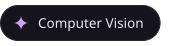
  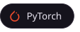
  
  
  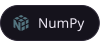
  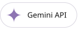
  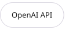

 

### `/ achievements`

  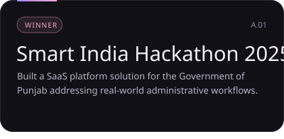
  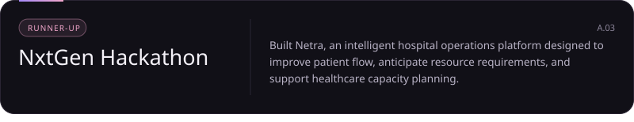
  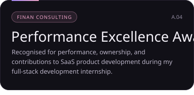
  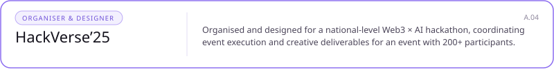

 

### `/ projects`

  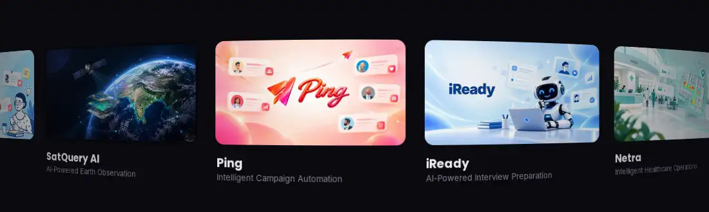

<a href="https://github.com/BHAVNAJAY/SatQueryAI">SatQuery AI</a> · <a href="https://ping-ecru-nu.vercel.app/">Ping</a> · <a href="https://i-ready-alpha.vercel.app/">iReady</a> · <a href="https://github.com/BHAVNAJAY/Netra">Netra</a> · <a href="https://github.com/BHAVNAJAY/Eco-Learn">EcoLearn</a> · <a href="https://notify-yh0m.onrender.com/">Notify</a>

 

### `/ github-insights`

  
  

  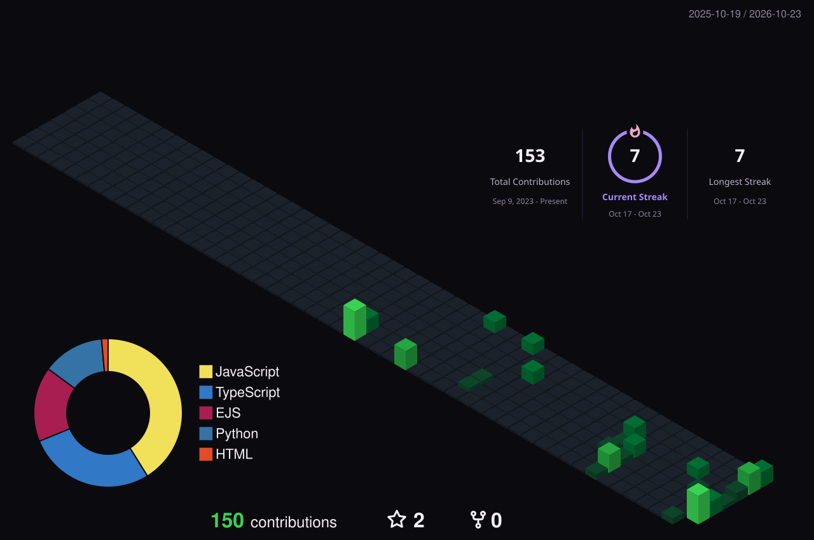

 

### `/ currently-exploring`

`RAG` · `LLM Fine-Tuning` · `Agentic AI` · `AI System Architecture` · `Semantic Search` · `Generative AI` · `Computer Vision` · `Intelligent Automation`

### `/ contact`

  

